[English](./README.en.md) · [Website](https://redloop.lei6393.com) · [GitHub](https://github.com/SuperMarioYL/redloop)

<picture>
  <source media="(max-width: 600px) and (prefers-color-scheme: dark)" srcset="./assets/presentation/hero-mobile-dark.svg">
  <source media="(max-width: 600px)" srcset="./assets/presentation/hero-mobile-light.svg">
  <source media="(prefers-color-scheme: dark)" srcset="./assets/presentation/hero-dark.svg">
  
</picture>

# RedLoop

**把重放的注入转成可检查的训练记录。**

RedLoop 生成攻击示例，在内置工具循环中重放，并为成功触发的禁止调用导出轨迹与建议安全响应。

## 为什么需要它

可复用示例需要的不只是载荷字符串。把注入位置、观察到的调用与期望安全行为放在一起，便于审阅候选训练记录。

- **保留完整示例** — 载荷、位置、结果与轨迹保存在一起。
- **无密钥复现** — 示例与确定性生成器可本地运行。
- **检查生成模式** — 报告区分模型生成与确定性回退。

## 架构

<picture>
  <source media="(max-width: 600px) and (prefers-color-scheme: dark)" srcset="./assets/presentation/architecture-mobile-dark.svg">
  <source media="(max-width: 600px)" srcset="./assets/presentation/architecture-mobile-light.svg">
  <source media="(prefers-color-scheme: dark)" srcset="./assets/presentation/architecture-dark.svg">
  
</picture>

attacker 提供种子变体或可选模型生成载荷；replay 构造新的确定性内存工具目标并记录禁止调用。hardening 将 attack、outcome、safe_response、exploit_trace 序列化，报告汇总重放结果。

| 组件 | 职责 |
| --- | --- |
| `Payload generation` | redloop/attacker.py |
| `Fresh replay` | redloop/replay.py |
| `In-memory target` | redloop/target.py |
| `Training records` | redloop/harden.py |

## 安装与快速上手

使用仓库清单声明的运行时版本。以下源码安装步骤可复现随仓示例。

```bash
git clone https://github.com/SuperMarioYL/redloop.git
cd redloop
python3.12 -m venv .venv
source .venv/bin/activate
python -m pip install -e .
```

需要 Python 3.12+；重放完整随仓 fixture，并从临时目录回读 JSONL 记录。

```bash
.venv/bin/python examples/presentation_demo.py
```

## 实际运行示例

<picture>
  <source media="(max-width: 600px) and (prefers-color-scheme: dark)" srcset="./assets/presentation/process-mobile-dark.svg">
  <source media="(max-width: 600px)" srcset="./assets/presentation/process-mobile-light.svg">
  <source media="(prefers-color-scheme: dark)" srcset="./assets/presentation/process-dark.svg">
  
</picture>

The mock target records read_file then send_email and exports one training record; no email leaves the process.

```text
{
  "target": "deterministic in-memory agent",
  "calls": [
    "read_file",
    "send_email"
  ],
  "hijacked": true,
  "severity": "data_exfil",
  "simulated_mailbox_entries": 1,
  "training_records": 1,
  "record_fields": [
    "attack",
    "exploit_trace",
    "outcome",
    "safe_response"
  ]
}
```

完整命令与输出保存在 [docs/demo-results.json](./docs/demo-results.json). 输入和复现代码均随仓提供。


保留已有录制供参考；上方文字示例给出当前可复现的操作。

## 用法

安装后在仓库根目录运行以下命令；处理自己的数据时替换相应路径。

```bash
redloop run --preset demo --emit demo-hardening.jsonl
redloop probe
# Review redloop.toml before a campaign:
redloop run --no-emit --n 4
```

## 配置

redloop.toml 配置 attacker 的 model、base_url、temperature、n_attacks、max_tokens、timeout；target 配置 forbidden_tools、max_steps 与可选 system_prompt。REDLOOP_ATTACKER_KEY 启用在线攻击生成。无密钥时普通 run 使用确定性生成，API 失败也可能回退，因此须检查 attacker_mode。--no-emit 不输出文件；--emit 指定 JSONL，每轮会覆盖。

## 集成与职责分工

<picture>
  <source media="(max-width: 600px) and (prefers-color-scheme: dark)" srcset="./assets/presentation/integrations-mobile-dark.svg">
  <source media="(max-width: 600px)" srcset="./assets/presentation/integrations-mobile-light.svg">
  <source media="(prefers-color-scheme: dark)" srcset="./assets/presentation/integrations-dark.svg">
  
</picture>

根据工作流选择输入与输出路径。本文本地示例验证其中明确说明的子流程。

| 路径 | 已实现职责 |
| --- | --- |
| Seed payloads | Deterministic attack variants |
| OpenAI-compatible API | Optional attacker generation |
| Mock tool loop | In-memory files and mailbox |
| HardeningPair JSONL | Trace and suggested safe response |
| TOML | Attacker and target settings |

## 限制与后续方向

- 目标是刻意朴素的规则模拟器，不是在线 LLM Agent；其命中率不衡量外部 Agent 或模型的安全性。
- send_email 只写内存邮箱，示例不发送邮件或用户数据。forbidden_tools 用来标注检测到的调用，不是运行时阻断策略。
- 导出的 safe_response 是待审阅模板；工具未进行微调或测量防护改善。

自带 Agent 适配器与真实目标部署评估仍是后续方向；生成示例用于训练前需审阅。

## 许可与贡献

许可见 [LICENSE](./LICENSE). 反馈问题时请提供最小输入、执行命令和实际输出。
